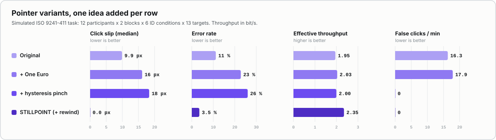
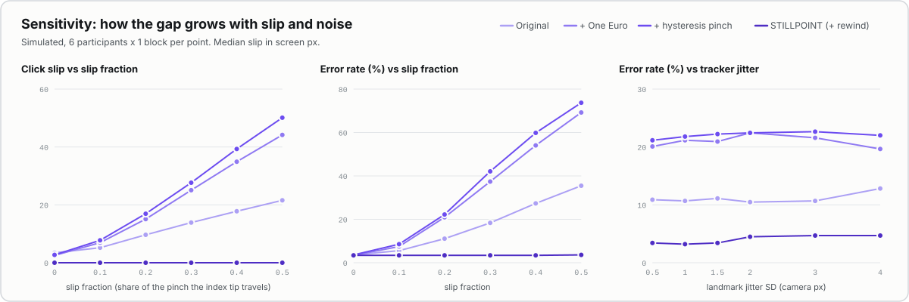
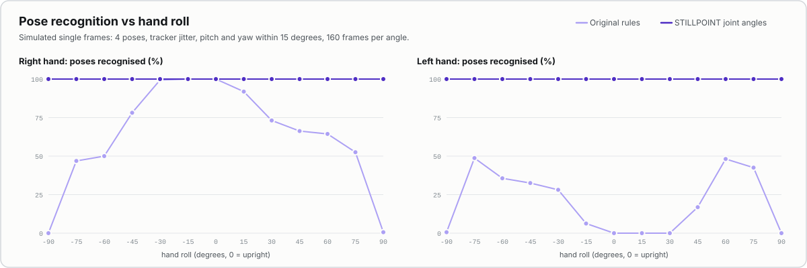
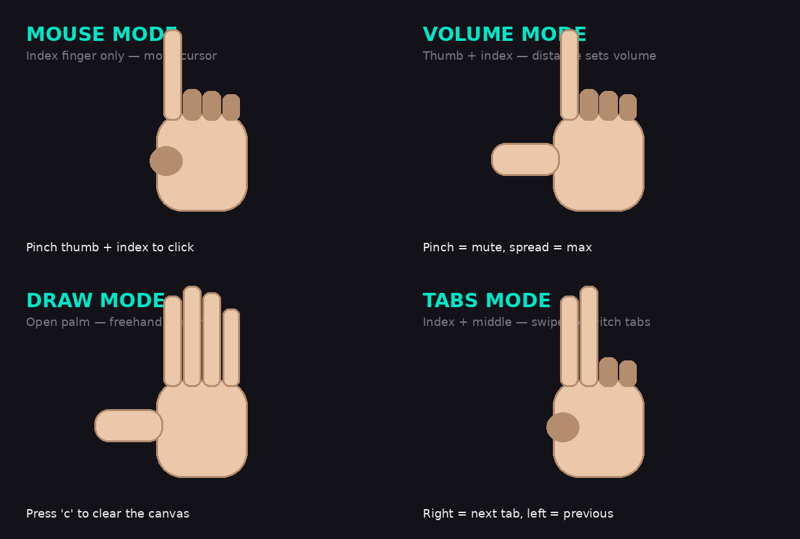
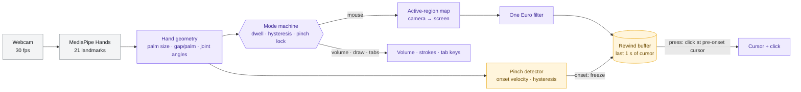

<!-- ════════════════════════════════════════════════════════════════════ -->
<!--                              STILLPOINT                               -->
<!-- ════════════════════════════════════════════════════════════════════ -->

<div align="center">

<!-- animated banner: hand-built SVG + SMIL -->


<br/>

[](LICENSE)
[](#-hardware)
[](#-run-it)
[](#-reproduce-the-results)
[](#-results)
[](#-contributing)

**Mid-air hand control for your laptop that clicks where you meant, not where your hand slipped.**
Point with your index finger, pinch to click. The pinch no longer drags the click off target.

[🔬 The idea](#-the-idea) · [📊 Results](#-results) · [✨ Features](#-features) · [🛠 How it works](#-how-it-works) · [🚀 Run it](#-run-it) · [🧪 Reproduce](#-reproduce-the-results) · [❓ FAQ](#-faq)

</div>

> [!IMPORTANT]
> Every number on this page comes from a **simulated** user study (a kinematic hand model with webcam-style tracker noise), produced by `python -m stillpoint.evaluate` and saved in [`results/fitts_sim.json`](results/fitts_sim.json). The live app runs on a real webcam and a real-user Fitts test ships with it, but **no real-user study has been run yet**. That harness is waiting for participants.

*Formerly **Gesture Controlled Laptop**.*

---

## 🛰 What is it?

A webcam watches your hand. MediaPipe finds 21 points on it, 30 times a second. STILLPOINT turns those points into a mouse cursor (index finger), clicks (pinch thumb and index), system volume (thumb and index apart), freehand drawing (open palm) and tab switching (two-finger swipe).

Every hand-tracking mouse has the same flaw: **to click, you pinch, and pinching moves the fingertip that steers the cursor.** The click lands a little below and beside where you aimed. On a small target, that is a miss. STILLPOINT notices the pinch *starting*, freezes the cursor, and places the click where the cursor was *before* your fingers began to move.

---

## 🔬 The idea

**Claim (falsifiable).** Rewinding the click to the cursor position just before pinch onset, on top of One Euro filtering, removes click-induced cursor slip. In a simulated ISO 9241-411 study (12 participants × 2 blocks × 6 ID conditions × 13 targets, 1,872 measured trials per variant), it **cuts median click slip from 9.9 px to 0.0 px** (90th percentile 17.0 px to 1.9 px), **error rate from 11.2 % to 3.5 %**, and **raises effective throughput from 1.95 to 2.35 bit/s** (paired difference +0.40 bit/s, 95 % CI 0.34 to 0.46, sign-flip p = 0.0005) compared with the original controller. If a real-user run of the bundled harness shows no drop in slip or errors at matched throughput, the claim is wrong.

**Why it happens.** Bowman et al. (2001) called it the *Heisenberg effect* of spatial input: the act of confirming a selection disturbs the position being confirmed. In a pinch, the index tip travels part of the way to meet the thumb. With the original project's mapping (1,080 camera pixels stretched over 1,920 screen pixels), a centimetre of fingertip travel is tens of screen pixels.

**What STILLPOINT does about it.**

1. **Pinch onset from aperture velocity.** The thumb-index gap is divided by palm size, so it reads the same at 40 cm and at 1 m from the camera. When it starts falling fast (2 palm widths per second), the cursor freezes.
2. **Rewind.** A one-second ring buffer of cursor states lets the click go to the last sample before the gap began to fall, not to where the drifting fingertip is when the pinch completes. The cursor stays frozen until you let go.
3. **One Euro filter** (Casiez, Roussel and Vogel, 2012) in place of the fixed `x += (target - x) / 5` smoothing: heavy smoothing when still, light when moving. Tuned on a held-out seed to be as steady as the original at rest while cutting its lag during a fast reach from 87 px to 10 px ([`tools/tune_oneeuro.py`](tools/tune_oneeuro.py)).
4. **Hysteresis pinch.** Press below 0.22 palm units, release above 0.32. One click per pinch, no `sleep(0.25)`, no double clicks.

**A finding worth stating.** A better filter alone makes slip *worse* (9.9 px to 16.1 px), because a responsive cursor follows the slipping fingertip faster. The rewind is what fixes it.

**Related work.**
- D. A. Bowman, C. A. Wingrave, J. M. Campbell, V. Q. Ly. *Using Pinch Gloves for both natural and abstract interaction techniques in virtual environments.* HCI International, 2001. (The Heisenberg effect.)
- G. Casiez, N. Roussel, D. Vogel. *1€ filter: a simple speed-based low-pass filter for noisy input in interactive systems.* CHI 2012.
- P. M. Fitts. *The information capacity of the human motor system in controlling the amplitude of movement.* Journal of Experimental Psychology 47(6), 1954.
- R. W. Soukoreff, I. S. MacKenzie. *Towards a standard for pointing device evaluation, perspectives on 27 years of Fitts' law research in HCI.* International Journal of Human-Computer Studies 61(6), 2004.
- ISO 9241-411:2012. *Ergonomics of human-system interaction, Part 411: Evaluation methods for the design of physical input devices.*
- F. Zhang et al. *MediaPipe Hands: On-device real-time hand tracking.* arXiv:2006.10214, 2020.

---

## 📊 Results

<div align="center">

</div>

Four pointer variants, each adding one idea to the one above. Same simulated people, same aims, same noise for every variant.

| Variant | Median slip | 90th pct slip | Error rate | Throughput | False clicks / min |
| --- | ---: | ---: | ---: | ---: | ---: |
| Original (exact port of the old code) | 9.9 px | 17.0 px | 11.2 % | 1.95 bit/s | 16.3 |
| + One Euro filter | 16.1 px | 30.6 px | 22.8 % | 2.03 bit/s | 17.9 |
| + hysteresis pinch | 18.3 px | 30.9 px | 26.0 % | 2.00 bit/s | 0.0 |
| **STILLPOINT** (+ onset rewind) | **0.0 px** | **1.9 px** | **3.5 %** | **2.35 bit/s** | **0.0** |

- **Slip** is the distance from where the cursor was at true pinch onset to where the click landed (screen px). A median of 0.0 px means the rewind returned the exact pre-onset frame in more than half of the clicks.
- **Throughput** is ISO effective throughput, mean of means (Soukoreff and MacKenzie, 2004): per condition, We = 4.133 × SD of endpoint deviation on the task axis, IDe = log2(De/We + 1), TP = IDe/MT.
- **False clicks** for the original are mostly double clicks: after its 0.25 s sleep a pinch still held clicks again (14.5 per minute), plus 1.8 per minute from its fixed 30-pixel threshold misfiring when the hand drifts far from the camera.

<details>
<summary><b>Simulation method and every assumption</b></summary>
<br>

Closed loop at 30 fps: the simulated user watches the pipeline's cursor and waits for it to settle before pinching, so a laggy filter really costs time. Code: [`stillpoint/sim.py`](stillpoint/sim.py), [`stillpoint/participants.py`](stillpoint/participants.py), [`stillpoint/handmodel.py`](stillpoint/handmodel.py).

| Assumption | Value |
| --- | --- |
| Task | ISO 9241-411 multidirectional, 13 targets per circle, D ∈ {300, 600} px, W ∈ {40, 80, 120} px on a 1920 × 1080 screen (nominal ID 1.8 to 4.1 bit) |
| Reach time | Fitts' law, a = 0.20 s, b = 0.22 s/bit, ×0.85 to 1.15 per person (an assumption chosen to land overall throughput near 2 bit/s, not fitted to data) |
| Reach shape | minimum jerk |
| Endpoint noise | per-axis SD = W / 5.08 (motor noise alone misses about 4 %), ×0.85 to 1.15 per person |
| Settle rule | wait 0.10 to 0.20 s and until the cursor is below 60 px/s, at most 0.6 s |
| Pinch | close 0.12 to 0.22 s, hold 0.08 to 0.20 s, reopen 0.12 to 0.22 s (minimum jerk); rest gap 0.6 to 1.0 palm units, closed gap 0.08 to 0.16 |
| **Slip fraction** | **0.20** of the closing distance travelled by the index tip (± 0.05 per person, ± 0.03 per pinch); swept 0 to 0.5 below |
| Hand | 100 to 170 px palm length at 1280 × 720, roll ±20°, pitch and yaw ±15° |
| Tracker jitter | 1.5 px SD per landmark (half shared by the whole hand), z twice as noisy; swept 0.5 to 4 px below |
| Tremor | 8 to 12 Hz, 0.3 to 0.8 px |
| Dropped frames | 2 % of frames return no hand |
| Hover | 6 s after each circle: hand wanders, thumb drifts to 0.30 to 0.45 palm units of the index, hand moves ±20 % nearer and farther; any click there is false |

Paired over the 12 participants (STILLPOINT minus original): slip −10.3 px (95 % CI −12.5 to −8.4), error rate −7.6 points (−11.0 to −4.6), throughput +0.40 bit/s (0.34 to 0.46); sign-flip p ≤ 0.001 for all three. These intervals describe the simulated population only.
</details>

### Sensitivity

<div align="center">

</div>

With no slip at all (fraction 0) every variant sits near the 3.5 % motor-noise floor, so the rewind costs nothing when there is nothing to fix. At a slip fraction of 0.5 the original misses 35.5 % of targets and the filtered variants 69 to 74 %; STILLPOINT stays at 3.6 %. Raising tracker jitter to 4 px moves STILLPOINT from 3.4 % to 4.7 % errors.

### Mode switching (secondary)

<div align="center">

</div>

The original read fingers by comparing raw x and y values, which assumes an upright right hand. STILLPOINT reads them from joint angles (unchanged by rotation) and measures the thumb along the hand's own knuckle line (the same for either hand), with hysteresis, a 0.2 s dwell before any mode change, and a lock while you pinch. During the simulated pointing sessions the original rules left mouse mode in 22 % of frames for right hands and 75 % for left hands; STILLPOINT never did. These numbers depend on the hand model's thumb posture, so treat them as a check, not a headline.

---

## ✨ Features

<table>
<tr>
<td width="33%" valign="top">

### ⏪ Pinch-onset rewind
The cursor freezes the moment your fingers start to close, and the click goes to where it was just before. Measured on the scale-free thumb-index gap, so distance from the camera does not matter.

</td>
<td width="33%" valign="top">

### 🪶 One Euro filtering
Steady when you hold still, quick when you move. Tuned on a held-out seed: as steady as the original at rest, with a fraction of its lag.

</td>
<td width="33%" valign="top">

### 🤏 One pinch, one click
Two thresholds in palm units instead of 30 pixels, so no chatter, no double clicks, and the same feel at arm's length or up close.

</td>
</tr>
<tr>
<td valign="top">

### 🖐️ Four modes, kept
Mouse, volume, draw and tabs all work as before. Volume now follows the scale-free gap, and tab swipes are measured in hand widths.

</td>
<td valign="top">

### 🧭 Either hand, any tilt
Finger states from joint angles and a dwell-and-lock mode machine, so a tilted or left hand, or a pinch, does not flip you into the wrong mode.

</td>
<td valign="top">

### 📏 A real Fitts harness
`fitts_app` runs the ISO task in its own window from the live pipeline (no OS cursor needed) and logs every trial; `analyze` turns the logs into throughput per variant.

</td>
</tr>
</table>

### Gestures

| Gesture | Mode | What it does |
| --- | --- | --- |
| ☝️ Index finger only | **Mouse** | Move the cursor with your fingertip. Pinch thumb and index to click. |
| 🤏 Thumb + index | **Volume** | The gap between the two fingertips sets the system volume (Windows). Pinch to mute, spread for max. |
| 🖐️ Open palm | **Draw** | Freehand drawing on the preview with your index finger. Press `c` to clear. |
| ✌️ Index + middle | **Tabs** | Swipe right for the next tab (`Ctrl+Tab`), left for the previous one. |

<div align="center">

</div>

---

## 🛠 How it works



The amber boxes are the new part. Each frame, the filtered cursor goes into the buffer along with the normalised gap. When the gap's closing speed passes the onset threshold, the pointer walks back through the buffer to the last sample before the gap began to fall and holds the cursor there. When the gap crosses the press threshold, the click goes to that held position. Releasing the pinch unfreezes the cursor.

The decision logic ([`controller.py`](stillpoint/controller.py)) makes no OS calls; [`app.py`](stillpoint/app.py) executes its actions with PyAutoGUI and pycaw. That split is what lets every mode be tested headless.

---

## 🔩 Hardware

| Part | Role | Cost |
| --- | --- | --- |
| Any webcam (720p, 30 fps) | Sees your hand | built into most laptops, or about $15 |
| A laptop or desktop | Runs MediaPipe on the CPU | you have one |

No GPU, no gloves, no markers.

---

## 📏 Specs (honest)

| Item | Status |
| --- | --- |
| Pointer variants, rewind, One Euro, hysteresis | Implemented and unit-tested |
| Simulated ISO 9241-411 study | Run: numbers above |
| Live app on a real webcam | Implemented; needs a camera, so not exercised by the automated tests |
| Real-user Fitts study | **Not run yet.** `fitts_app` and `analyze` are ready and tested on synthetic logs |
| Slip fraction of real pinches | **Not measured.** 0.20 is an assumption; the sweep covers 0 to 0.5 |
| Users who pinch while still moving | **Not modelled.** The simulated user settles first; overlapping reach and pinch would shorten the clean pre-onset window |
| Tracker latency and motion blur | **Not modelled.** Jitter and dropped frames are; MediaPipe's own lag is not |
| MediaPipe z (depth) quality | **Not validated.** Joint angles use z; the model gives it twice the x/y noise |
| Volume control | Windows only (pycaw); other systems show the level without changing it |

---

## 🚀 Run it

<table>
<tr>
<td width="50%" valign="top">

### 🙂 For users

1. Install Python 3.10 or newer.
2. `pip install -r requirements.txt`
3. `python -m stillpoint.app`
4. Raise one index finger to move, pinch to click. `q` quits.

Newer MediaPipe builds (no `mp.solutions`) need the hand model once: download `hand_landmarker.task` from the [MediaPipe hand landmarker page](https://developers.google.com/mediapipe/solutions/vision/hand_landmarker) into `models/`, or pass `--model PATH`.

</td>
<td width="50%" valign="top">

### 🧑‍💻 For developers

```bash
git clone https://github.com/Zero-State-Logic/Stillpoint
cd Stillpoint
pip install -r requirements.txt
python -m unittest discover -s tests -v
```

```bash
python -m stillpoint.app --variant baseline   # the old behaviour
python -m stillpoint.app --dry-run            # decide, but touch nothing
python -m stillpoint.fitts_app --participant P01 --variant stillpoint
python -m stillpoint.analyze logs/*.csv
```

</td>
</tr>
</table>

`--hand left|right` follows one hand when two are in view. `--camera N` picks another webcam.

---

## 🧪 Reproduce the results

```bash
python -m unittest discover -s tests -v   # 84 tests, about 20 s, numpy only
python -m stillpoint.evaluate             # about 6 min on 8 cores
python tools/tune_oneeuro.py              # how the filter parameters were chosen
```

`evaluate` rewrites [`results/fitts_sim.json`](results/fitts_sim.json) and the three charts in [`docs/assets/`](docs/assets). It is seeded (`--seed 1`), and every variant sees identical simulated people and noise, so reruns give the same numbers. `--quick` does a two-participant smoke run.

**Run the real study.** For each participant, run `fitts_app` once per variant in a counterbalanced order (for example `baseline` and `stillpoint`, two blocks each), then `python -m stillpoint.analyze logs/*.csv --json results/user_study.json`.

---

## 📁 Project layout

```
Stillpoint/
├─ stillpoint/
│  ├─ filters.py      🪶 One Euro filter + the original fixed smoother
│  ├─ hand.py         ✋ palm size, scale-free gap, joint-angle finger states
│  ├─ pinch.py        🤏 hysteresis pinch, onset velocity, rewind buffer
│  ├─ pointer.py      🎯 the pipeline and its four variants
│  ├─ gestures.py     🧭 dwell-and-lock mode machine
│  ├─ legacy.py       📼 the original rules, kept as the baseline
│  ├─ controller.py   🧠 per-mode decisions (no OS calls)
│  ├─ app.py          🖥️ live app: camera, MediaPipe, PyAutoGUI, pycaw
│  ├─ tracking.py     📷 MediaPipe solutions / tasks backends
│  ├─ fitts.py        📏 ISO 9241-411 layouts and metrics
│  ├─ handmodel.py    🦴 kinematic hand that writes 21 landmarks
│  ├─ participants.py 👥 simulated people and their assumptions
│  ├─ sim.py          🔁 closed-loop session simulator
│  ├─ simmodes.py     🧭 mode-stability counters and the roll sweep
│  ├─ evaluate.py     📊 the study, sweeps, stats → results JSON
│  ├─ charts.py       📈 README charts (svgchart.py draws them)
│  ├─ stats.py        🧮 sign-flip test, bootstrap CI
│  ├─ fitts_app.py    🎯 live real-user Fitts test
│  ├─ fittstask.py    🗒️ task sequencing + CSV log
│  └─ analyze.py      🧾 logs → throughput per variant
├─ tests/             🧪 84 unit and smoke tests
├─ tools/             🔧 tune_oneeuro.py
├─ results/           📦 fitts_sim.json
└─ docs/assets/       🖼️ hero, charts, gesture images
```

---

## 🗺 Roadmap

- [x] Exact port of the original controller as a baseline
- [x] One Euro filter, scale-free hysteresis pinch, pinch-onset rewind
- [x] Joint-angle finger states, dwell-and-lock mode machine, either hand
- [x] Simulated ISO 9241-411 study with sensitivity sweeps
- [x] Live Fitts harness and log analysis
- [ ] Real-user study (12 or more people, counterbalanced) with the bundled harness
- [ ] Measure the real slip fraction from recorded pinches
- [ ] Adaptive onset threshold per user
- [ ] Drag and right-click gestures

---

## 🤝 Contributing

Students and first-time contributors welcome. The most useful thing you can do right now is **run the Fitts test on yourself** (`fitts_app`, both variants) and open an issue with your `analyze` output. New gestures go in `controller.py` with a test in `tests/test_gestures.py`.

---

## ❓ FAQ

<details>
<summary><b>Is the improvement real or only simulated?</b></summary>
<br>
So far only simulated. The simulator is a model with stated assumptions (table above), and the biggest one, how far the index tip moves during a pinch, is swept rather than fixed. The real-user test is in the repo; results will be added when there are participants.
</details>

<details>
<summary><b>Does the freeze make the cursor feel sticky?</b></summary>
<br>
It only engages when the thumb-index gap closes faster than 2 palm widths per second, and it lets go if no press follows within 0.4 s or the fingers reopen. In the simulation, normal pointing and hovering never produced a false click.
</details>

<details>
<summary><b>Why is the One Euro row worse than the original?</b></summary>
<br>
The original's heavy smoothing hides part of the slip by lagging behind it. A responsive filter follows the fingertip, slip included. Filtering alone cannot fix slip; the rewind can.
</details>

<details>
<summary><b>MediaPipe says it has no <code>solutions</code> module.</b></summary>
<br>
Recent MediaPipe releases dropped <code>mp.solutions</code>. STILLPOINT then uses the HandLandmarker task, which needs <code>hand_landmarker.task</code>. Download it from the MediaPipe hand landmarker page into <code>models/</code> or pass <code>--model PATH</code>.
</details>

<details>
<summary><b>Does it work on macOS and Linux?</b></summary>
<br>
The cursor, clicks, drawing and tabs use PyAutoGUI, which works on all three. Volume control uses pycaw and is Windows only.
</details>

---

## 📜 License

MIT, free for any use. See [LICENSE](LICENSE).

## 🙏 Acknowledgements

Built on [MediaPipe](https://developers.google.com/mediapipe), [OpenCV](https://opencv.org/), [PyAutoGUI](https://github.com/asweigart/pyautogui), [pycaw](https://github.com/AndreMiras/pycaw) and [NumPy](https://numpy.org/). The filter is the 1€ filter of Casiez, Roussel and Vogel; the evaluation follows ISO 9241-411 as described by Soukoreff and MacKenzie.

<div align="center">
<br>
<b>If you have a webcam and ten minutes, run the Fitts test and send your numbers.</b>
<br><br>
<sub>STILLPOINT · point, pinch, and the click stays put</sub>
</div>
